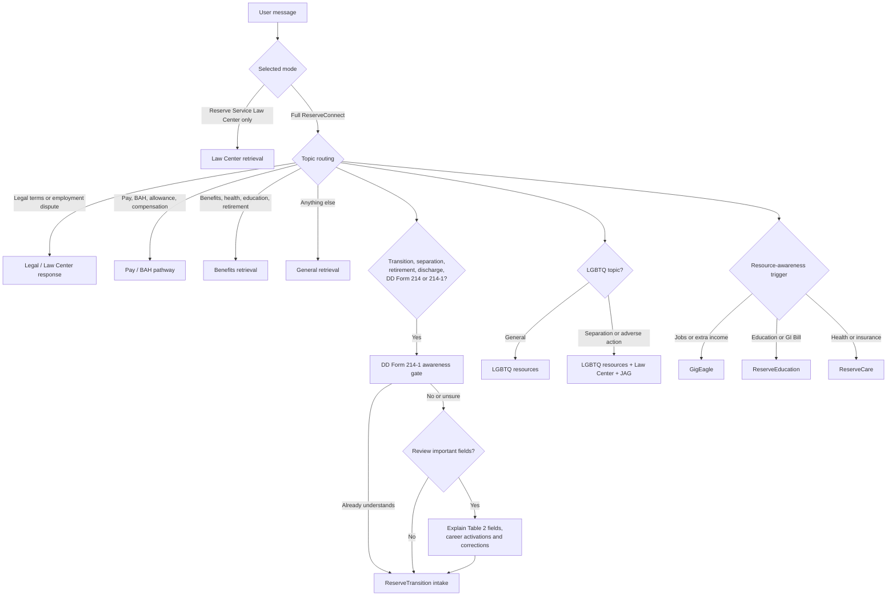
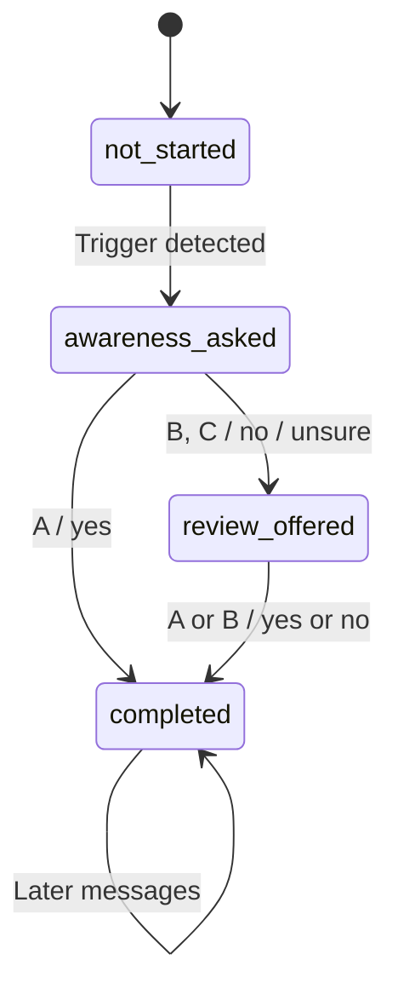

# ReserveConnect Curated Conversation Map

This document inventories the chatbot's programmed conversation behavior. It separates true stateful pathways from prompt-driven rules and UI starter questions, because they behave differently when new pathways are added.

## At a glance



## Implementation levels

| Level | Meaning | Current examples |
|---|---|---|
| Stateful | The server stores a named state and deterministically advances it from the user's answer. | DD Form 214-1 awareness gate |
| Prompt-driven sequence | The model is instructed to ask questions in order, but the server does not store each answer or stage. | ReserveTransition intake, Pay/BAH gate |
| Response rule | A topic trigger requires specific text, links, or a banner in the answer. | LGBTQ, GigEagle, ReserveEducation, ReserveCare |
| UI starter question | A button submits ordinary text. It has no pathway logic of its own. | Transition, law, VA, pay, special pay, benefits buttons |

## 1. DD Form 214-1 awareness pathway

**Implementation:** Stateful  
**Priority:** Runs before the broader ReserveTransition intake.

### Triggers

- Transition or transitioning
- Separation or administrative separation
- Retirement
- Getting out
- Leaving active duty, military service, Guard, Reserve, or a Reserve Component
- Discharge
- Release from active duty
- DD Form 214 or DD Form 214-1

### State map



### Questions and branches

| Stage | Bot question | Accepted answer | Result |
|---|---|---|---|
| Awareness | “Before we continue, do you know what a DD Form 214-1 is and why it can be important to your benefits now and in the future?” | A / Yes | End the awareness gate and continue the user's transition topic. |
| Awareness | Same question | B / No; C / Not sure | Briefly explain the paired DD Form 214 and 214-1, then offer the review. |
| Review offer | “Would you like to review the most important information to verify on your DD Form 214-1?” | A / Yes | Explain the required fields and career activation history. |
| Review offer | Same question | B / No | End the awareness gate and continue the transition topic. |
| Completion | “Do you have any other questions about your DD Form 214 or DD Form 214-1?” | Free text | Answer using DoDI 1336.01; the awareness gate does not restart. |

### Required information when review is accepted

- Total Active, Inactive, and Career Points
- Total Points for Retired Pay
- Total Service for Pay
- Creditable Service for Retired Pay
- NRR Age Reduction Amount and projected pay date, when applicable
- All career activations, statutory authority, operation, dates, and foreign-country indicator
- Warning not to sign a known-incorrect DD Form 214 or 214-1
- Correction through the separation activity or servicing personnel office
- DoDI 1336.01 as the controlling source

## 2. ReserveTransition intake

**Implementation:** Server-owned intake keyed by a conversation ID. After the DD Form 214-1 pathway, the server asks Q1–Q3 directly, records each choice, and asks for clarification without advancing on ambiguous answers. The model receives the recorded answers only for final guidance. Mode switches and fresh page conversations use a new ID.

### Question 1 — separation type

- A) Separating before retirement eligibility
- B) Retiring with immediate pay
- C) Grey Area retiree
- D) Not sure; exploring options

### Question 2 — timeline

- A) Within 6 months
- B) 6–12 months
- C) 1–2 years
- D) Researching for now

### Question 3 — priority

- A) VA disability and health benefits
- B) Health insurance after leaving
- C) Employment or education
- D) Retirement pay and financial planning
- E) All options

### Routing after intake

| Q1 answer | Lead with |
|---|---|
| A — separating before retirement | SGLI conversion, VA intent to file, paired DD forms, health coverage bridge, then the Q3 priority |
| B — immediate retiree | Retirement orders, DFAS, TRICARE, SBP, VA claim, TSP |
| C — Grey Area retiree | Notice of Eligibility, DD Form 2656, TRICARE Retired Reserve, VA claim, state benefits |
| D — not sure | Explain A–C briefly and ask which situation is closest |

All ReserveTransition responses must end with the monthly virtual class and ROA contact information.

## 3. Pay and BAH pathway

**Implementation:** Prompt-driven gate with dedicated retrieval routing.

### Triggers

Pay, paycheck, drill pay, basic pay, BAH, BAS, allowances, mobilization pay, active-duty pay, special pay, hazardous-duty pay, hostile-fire pay, FSA, TSP contributions, or compensation.

### Questions and branches

| Stage | Bot question | Branch |
|---|---|---|
| Order length | “Are your orders for 30 days or fewer, or are they for more than 30 days?” | Do not provide a BAH analysis until answered. |
| Contingency status | For orders of 30 days or fewer: “Are these orders in support of a contingency operation?” | Yes generally routes to full BAH; no generally routes to BAH-RC. |

DoD FMR Volume 7A is the controlling source. The ROA duty-status matrix must not be used as the authority for pay policy.

## 4. Legal and Reserve Service Law Center pathway

**Implementation:** Retrieval route, required banner, and optional Law-Center-only mode.

### Triggers

Law, legal, attorney, JAG, USERRA, SCRA, UCMJ, employment disputes, firing, discrimination, reemployment, military leave, administrative separation, discharge, appeals, boards, PEB/MEB, line of duty, record correction, clearances, or rights.

### Behavior

- Prioritize Reserve Service Law Center material.
- Always use the complete current name “Reserve Service Law Center.”
- Add the Law Center banner once.
- Suggest two or three related legal or benefits questions.
- In Law-Center-only mode, redirect an out-of-scope question to the full navigator.

## 5. LGBTQ pathways

### LGBTQ resources

**Implementation:** Response rule.

Gay, lesbian, queer, bisexual, transgender, or LGBTQ topics require natural inclusion of:

- Sparta PRIDE
- Out in National Security

### LGBTQ separation or adverse action

**Implementation:** Response rule layered onto legal and transition behavior.

When LGBTQ terms appear with separation, discharge, transition, forced separation, or adverse action:

- Include both LGBTQ resources.
- Include the Reserve Service Law Center banner.
- Offer to retrieve the applicable DoD instruction and service regulation.
- Recommend verification with a JAG attorney.

## 6. Resource-awareness pathways

| Pathway | Trigger topics | Required response |
|---|---|---|
| GigEagle | Active-duty tours, jobs, gig work, flexible work, civilian employment compatible with reserve service, extra work or income | Explain GigEagle and include `https://gigeagle.mil/` once. |
| ReserveEducation | Education, college, university, GI Bill, scholarship, school, tuition, academic benefits | Include `https://roa.org/reserveeducation/` once. |
| ReserveCare | Health care, health/life/dental/vision insurance, coverage | Ask whether the user knows about ROA-sponsored ReserveCare and include `https://www.roainsure.com` once. |

## 7. UI starter questions

These buttons submit text into the normal router; they are not independent flows.

### Full ReserveConnect

1. Transitioning out of the Guard/Reserve
2. Law, employment/reemployment, or UCMJ
3. VA disability
4. Pay problems
5. Special pay and compensation
6. Veteran benefits

### Reserve Service Law Center only

1. Fired, harassed, or denied promotion because of Guard/Reserve service
2. VA disability claim research
3. USERRA protections for pilots
4. Returning-to-work protections
5. Voting while out of state or overseas
6. What is USERRA?

## 8. How to add a new pathway

Define these items before editing code:

```text
Pathway name:
Purpose:
Priority relative to existing pathways:
Trigger phrases:
False-positive phrases to exclude:
Stateful or prompt-driven:

Question 1:
  A:
  B:
  C:

Question 2:
  ...

Required sources:
Required response facts:
Required links or banners:
Completion condition:
Fallback when the answer is unclear:
Can the pathway restart in the same conversation?
Tests for every trigger and answer branch:
```

### Recommended implementation rule

Use server-side state for any pathway where the order of questions or the user's selected answers affects the outcome. Use response rules only for one-message resource reminders. Do not rely only on the model's memory for a multi-question intake that must be consistent.

## 9. Current reliability gaps

- ReserveTransition intake state is held in server memory for an hour of inactivity; it is not durable across server restarts.
- Pay/BAH order-length and contingency answers are not stored as explicit server state.
- LGBTQ, GigEagle, ReserveEducation, and ReserveCare prompt contracts have fast tests in `config-rules.test.js`; run `BETA_FILTER="Resource referral" node beta-test.js` with a live chatbot for positive, negative, once-only, and overlap answer checks.
- Pathway definitions are spread across the system prompt, server routing, client state, and UI starter-question lists.

## Source locations

- Curated prompt rules: `chatbot/config.js`
- Routing, deterministic state, retrieval, and fallbacks: `chatbot/server.js`
- Embedded widget state and starter questions: `widget.js`
- Test-page state and starter questions: `chatbot/testpage.html`
- Core pathway tests: `chatbot/config-rules.test.js`
- Law Center and answer-finalization tests: `chatbot/law-center-mode.test.js`# ReserveConnect Curated Conversation Map

This document inventories the chatbot's programmed conversation behavior. It separates true stateful pathways from prompt-driven rules and UI starter questions, because they behave differently when new pathways are added.

## At a glance


## Implementation levels

| Level | Meaning | Current examples |
|---|---|---|
| Stateful | The server stores a named state and deterministically advances it from the user's answer. | DD Form 214-1 awareness gate |
| Prompt-driven sequence | The model is instructed to ask questions in order, but the server does not store each answer or stage. | ReserveTransition intake, Pay/BAH gate |
| Response rule | A topic trigger requires specific text, links, or a banner in the answer. | LGBTQ, GigEagle, ReserveEducation, ReserveCare |
| UI starter question | A button submits ordinary text. It has no pathway logic of its own. | Transition, law, VA, pay, special pay, benefits buttons |

## 1. DD Form 214-1 awareness pathway

**Implementation:** Stateful  
**Priority:** Runs before the broader ReserveTransition intake.

### Triggers

- Transition or transitioning
- Separation or administrative separation
- Retirement
- Getting out
- Leaving active duty, military service, Guard, Reserve, or a Reserve Component
- Discharge
- Release from active duty
- DD Form 214 or DD Form 214-1

### State map


### Questions and branches

| Stage | Bot question | Accepted answer | Result |
|---|---|---|---|
| Awareness | “Before we continue, do you know what a DD Form 214-1 is and why it can be important to your benefits now and in the future?” | A / Yes | End the awareness gate and continue the user's transition topic. |
| Awareness | Same question | B / No; C / Not sure | Briefly explain the paired DD Form 214 and 214-1, then offer the review. |
| Review offer | “Would you like to review the most important information to verify on your DD Form 214-1?” | A / Yes | Explain the required fields and career activation history. |
| Review offer | Same question | B / No | End the awareness gate and continue the transition topic. |
| Completion | “Do you have any other questions about your DD Form 214 or DD Form 214-1?” | Free text | Answer using DoDI 1336.01; the awareness gate does not restart. |

### Required information when review is accepted

- Total Active, Inactive, and Career Points
- Total Points for Retired Pay
- Total Service for Pay
- Creditable Service for Retired Pay
- NRR Age Reduction Amount and projected pay date, when applicable
- All career activations, statutory authority, operation, dates, and foreign-country indicator
- Warning not to sign a known-incorrect DD Form 214 or 214-1
- Correction through the separation activity or servicing personnel office
- DoDI 1336.01 as the controlling source

## 2. ReserveTransition intake

**Implementation:** Server-owned intake keyed by a conversation ID. After the DD Form 214-1 pathway, the server asks Q1–Q3 directly, records each choice, and asks for clarification without advancing on ambiguous answers. The model receives the recorded answers only for final guidance. Mode switches and fresh page conversations use a new ID.

### Question 1 — separation type

- A) Separating before retirement eligibility
- B) Retiring with immediate pay
- C) Grey Area retiree
- D) Not sure; exploring options

### Question 2 — timeline

- A) Within 6 months
- B) 6–12 months
- C) 1–2 years
- D) Researching for now

### Question 3 — priority

- A) VA disability and health benefits
- B) Health insurance after leaving
- C) Employment or education
- D) Retirement pay and financial planning
- E) All options

### Routing after intake

| Q1 answer | Lead with |
|---|---|
| A — separating before retirement | SGLI conversion, VA intent to file, paired DD forms, health coverage bridge, then the Q3 priority |
| B — immediate retiree | Retirement orders, DFAS, TRICARE, SBP, VA claim, TSP |
| C — Grey Area retiree | Notice of Eligibility, DD Form 2656, TRICARE Retired Reserve, VA claim, state benefits |
| D — not sure | Explain A–C briefly and ask which situation is closest |

All ReserveTransition responses must end with the monthly virtual class and ROA contact information.

## 3. Pay and BAH pathway

**Implementation:** Prompt-driven gate with dedicated retrieval routing.

### Triggers

Pay, paycheck, drill pay, basic pay, BAH, BAS, allowances, mobilization pay, active-duty pay, special pay, hazardous-duty pay, hostile-fire pay, FSA, TSP contributions, or compensation.

### Questions and branches

| Stage | Bot question | Branch |
|---|---|---|
| Order length | “Are your orders for 30 days or fewer, or are they for more than 30 days?” | Do not provide a BAH analysis until answered. |
| Contingency status | For orders of 30 days or fewer: “Are these orders in support of a contingency operation?” | Yes generally routes to full BAH; no generally routes to BAH-RC. |

DoD FMR Volume 7A is the controlling source. The ROA duty-status matrix must not be used as the authority for pay policy.

## 4. Legal and Reserve Service Law Center pathway

**Implementation:** Retrieval route, required banner, and optional Law-Center-only mode.

### Triggers

Law, legal, attorney, JAG, USERRA, SCRA, UCMJ, employment disputes, firing, discrimination, reemployment, military leave, administrative separation, discharge, appeals, boards, PEB/MEB, line of duty, record correction, clearances, or rights.

### Behavior

- Prioritize Reserve Service Law Center material.
- Always use the complete current name “Reserve Service Law Center.”
- Add the Law Center banner once.
- Suggest two or three related legal or benefits questions.
- In Law-Center-only mode, redirect an out-of-scope question to the full navigator.

## 5. LGBTQ pathways

### LGBTQ resources

**Implementation:** Response rule.

Gay, lesbian, queer, bisexual, transgender, or LGBTQ topics require natural inclusion of:

- Sparta PRIDE
- Out in National Security

### LGBTQ separation or adverse action

**Implementation:** Response rule layered onto legal and transition behavior.

When LGBTQ terms appear with separation, discharge, transition, forced separation, or adverse action:

- Include both LGBTQ resources.
- Include the Reserve Service Law Center banner.
- Offer to retrieve the applicable DoD instruction and service regulation.
- Recommend verification with a JAG attorney.

## 6. Resource-awareness pathways

| Pathway | Trigger topics | Required response |
|---|---|---|
| GigEagle | Active-duty tours, jobs, gig work, flexible work, civilian employment compatible with reserve service, extra work or income | Explain GigEagle and include `https://gigeagle.mil/` once. |
| ReserveEducation | Education, college, university, GI Bill, scholarship, school, tuition, academic benefits | Include `https://roa.org/reserveeducation/` once. |
| ReserveCare | Health care, health/life/dental/vision insurance, coverage | Ask whether the user knows about ROA-sponsored ReserveCare and include `https://www.roainsure.com` once. |

## 7. UI starter questions

These buttons submit text into the normal router; they are not independent flows.

### Full ReserveConnect

1. Transitioning out of the Guard/Reserve
2. Law, employment/reemployment, or UCMJ
3. VA disability
4. Pay problems
5. Special pay and compensation
6. Veteran benefits

### Reserve Service Law Center only

1. Fired, harassed, or denied promotion because of Guard/Reserve service
2. VA disability claim research
3. USERRA protections for pilots
4. Returning-to-work protections
5. Voting while out of state or overseas
6. What is USERRA?

## 8. How to add a new pathway

Define these items before editing code:

```text
Pathway name:
Purpose:
Priority relative to existing pathways:
Trigger phrases:
False-positive phrases to exclude:
Stateful or prompt-driven:

Question 1:
  A:
  B:
  C:

Question 2:
  ...

Required sources:
Required response facts:
Required links or banners:
Completion condition:
Fallback when the answer is unclear:
Can the pathway restart in the same conversation?
Tests for every trigger and answer branch:
```

### Recommended implementation rule

Use server-side state for any pathway where the order of questions or the user's selected answers affects the outcome. Use response rules only for one-message resource reminders. Do not rely only on the model's memory for a multi-question intake that must be consistent.

## 9. Current reliability gaps

- ReserveTransition intake state is held in server memory for an hour of inactivity; it is not durable across server restarts.
- Pay/BAH order-length and contingency answers are not stored as explicit server state.
- LGBTQ, GigEagle, ReserveEducation, and ReserveCare prompt contracts have fast tests in `config-rules.test.js`; run `BETA_FILTER="Resource referral" node beta-test.js` with a live chatbot for positive, negative, once-only, and overlap answer checks.
- Pathway definitions are spread across the system prompt, server routing, client state, and UI starter-question lists.

## Source locations

- Curated prompt rules: `chatbot/config.js`
- Routing, deterministic state, retrieval, and fallbacks: `chatbot/server.js`
- Embedded widget state and starter questions: `widget.js`
- Test-page state and starter questions: `chatbot/testpage.html`
- Core pathway tests: `chatbot/config-rules.test.js`
- Law Center and answer-finalization tests: `chatbot/law-center-mode.test.js`